<!-- سَنَد · Sanad — project showcase. Assets live in ./assets (self-hosted, no third-party widgets except shields.io badges). -->

<picture>
  <source media="(prefers-color-scheme: dark)" srcset="assets/hero-dark.svg">
  <source media="(prefers-color-scheme: light)" srcset="assets/hero-light.svg">
  
</picture>

 

  

        

  

<b><a href="#ar">العربية</a></b> &nbsp;·&nbsp; <b><a href="#en">English</a></b> &nbsp;·&nbsp; <a href="#showcase">العرض</a> &nbsp;·&nbsp; <a href="#features">الميزات</a> &nbsp;·&nbsp; <a href="#gallery">المعرض</a> &nbsp;·&nbsp; <a href="#architecture">المعمار</a> &nbsp;·&nbsp; <a href="#roadmap">الخطة</a> &nbsp;·&nbsp; <a href="#promises">وعودنا</a>


##  سَنَد في سطرين

**سَنَد** وكيل ذكي للموبايل بيفهم **مصري** وبيشتغل **على موبايلك إنت**: بيقرا الشاشة، وبيكمّل المهام خطوة بخطوة، وبيفتكر اللي يهمّك، وبيحمي عيلتك.
في 6.0 «الأفق» بقى عنده **جيش وكلاء** بيشتغل لحسابك أيام وأسابيع، جوه **دستور** واضح وقوانين و**موافقات**، وبيحرسه فريق أمن من وكلاء الذكاء الاصطناعي، و**القرار الأخير دايمًا لإنسان**.

> [!NOTE]
> المستودع ده خاص بالـCI بتاع سَنَد: بناء الـAPK والاختبارات واللقطات الحقيقية من محاكي Android. كل الصور هنا **لقطات حقيقية من المحاكي** لنسخة 5.0، ببيانات تجريبية فاضية، ومفيهاش أي بيانات لمستخدم أو لطفل.

##  العرض · Showcase

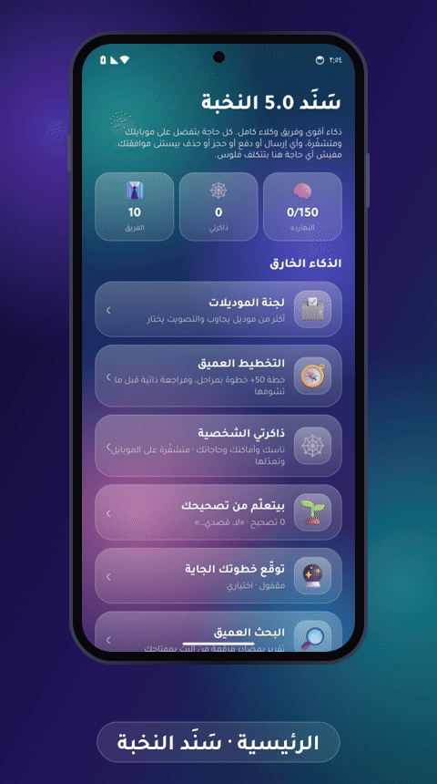

لقطات حقيقية من محاكي Android 14 · Real Android 14 emulator captures, sanad 5.0.0

##  الميزات · Features

<table>
<tr>
<td width="33%" valign="top">

<h3>الأقسام الخمسة</h3>
<b>Five home sections</b> 
عقل الوكيل، والأتمتة، والعيلة، وصحة الموبايل، والخصوصية. كل ميزة جديدة لازم تدخل تحت واحد منهم. 
Agent brain · Automations · Family · Phone health · Privacy
</td>
<td width="33%" valign="top">

<h3>جيش الوكلاء · 12 كتيبة</h3>
<b>The 6.0 agent army</b> 
قائد عام، و12 كتيبة (المال، والسفر، والدراسة، والصحة، والشغل…)، ووكلاء أحرار بيتولدوا عند الطلب، ومهام لحد 30 يوم. 
Commander, 12 battalions, free agents, a Reviewer and an Accountant
</td>
<td width="33%" valign="top">

<h3>دستور الوكلاء</h3>
<b>The constitution</b> 
10 مواد بتتفحص في الكود قبل كل فعل: الإنسان صاحب القرار، ومفيش تخفّي، ومفيش فعل غير قانوني. 
10 articles enforced in code before every action
</td>
</tr>
<tr>
<td width="33%" valign="top">

<h3>4 مستويات موافقة</h3>
<b>4 approval levels</b> 
🟢 حر · 🟡 بإذن عام · 🟠 بموافقة كل مرة · 🔴 بموافقة مشددة (بصمة + 10 ثواني للتراجع + سقف مبلغ). 
Free · standing grant · per-action · strict (biometric + undo window)
</td>
<td width="33%" valign="top">
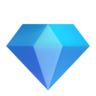
<h3>8 عضويات</h3>
<b>8 membership tiers</b> 
مجاني، وبلَس، وبرو، وعائلي، وأعمال، والأسود، والماسي «الأوائل»، والسيادي. <b>الأسعار مقترحة</b> والدفع مقفول. 
Free → Sovereign. Prices are <b>proposed</b>; payments are off
</td>
<td width="33%" valign="top">
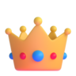
<h3>المالك + 5 رتب</h3>
<b>Owner + 5 admin ranks</b> 
نائب المالك، ومدير العمليات، ومشرف العضويات، ومراجع السوق، والمحلل. قاعدة الشخصين وسجل تدقيق محدش يمسحه. 
Two-person rule, passkey, append-only audit log
</td>
</tr>
<tr>
<td width="33%" valign="top">

<h3>مركز الأمن الذكي</h3>
<b>AI security center</b> 
الحارس، وصائد الاحتيال، والفريق الأحمر، والمصلّح، وقائد الطوارئ، والمدقق. ميشوفوش محتوى أي مستخدم. 
Six security agents that work on numbers and patterns only
</td>
<td width="33%" valign="top">

<h3>نظام العدل</h3>
<b>The fairness system</b> 
تذكير قبل التجديد بـ3 أيام، وإلغاء بضغطتين، واسترداد كامل 7 أيام، واعتراض يراجعه إنسان خلال 48 ساعة. 
Clear prices, 2-tap cancel, human appeal within 48 h
</td>
<td width="33%" valign="top">
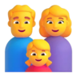
<h3>العيلة والحماية</h3>
<b>Family & safety</b> 
وضع الطفل، ووضع الجد والجدة، وكاشف أرقام النصب، وحلقة الأمان، والورثة الرقمي. كله بموافقة كل فرد. 
Child mode, grandparent mode, scam shield, consent-based circle
</td>
</tr>
</table>

##  المعرض · Gallery

<table>
<tr>
<td align="center" width="25%">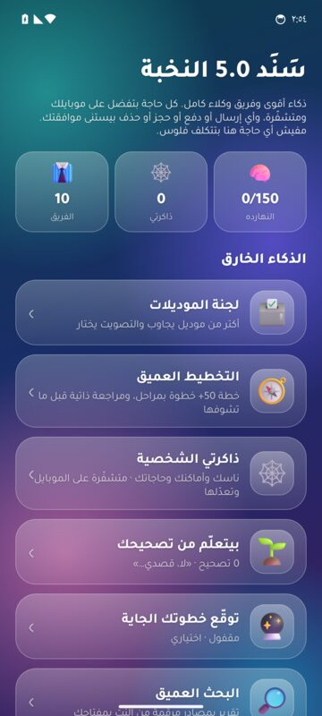 <b>الرئيسية · سَنَد النخبة</b></td>
<td align="center" width="25%">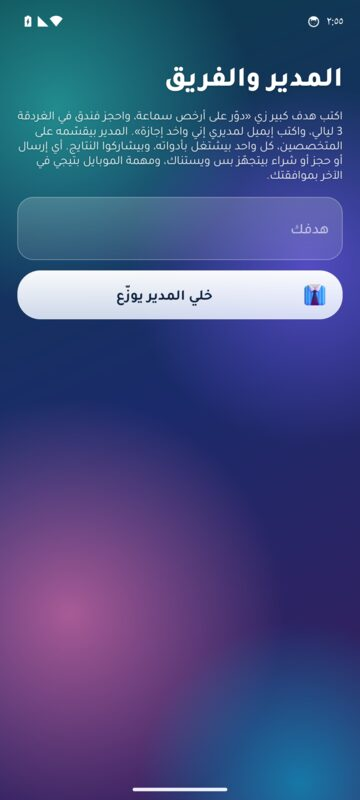 <b>أسطول الوكلاء</b></td>
<td align="center" width="25%"> <b>أفاتار سَنَد</b></td>
<td align="center" width="25%">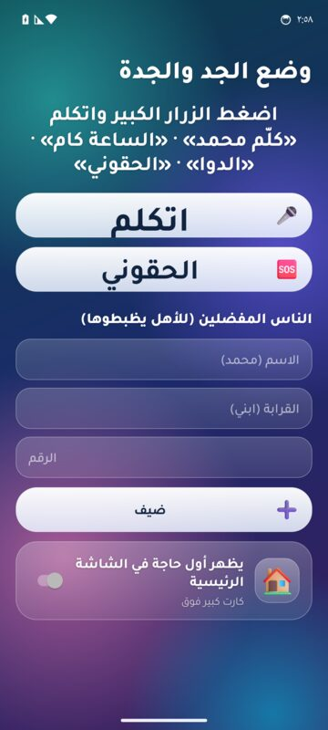 <b>وضع الجد والجدة</b></td>
</tr>
<tr>
<td align="center" width="25%"> <b>كيبورد سَنَد</b></td>
<td align="center" width="25%">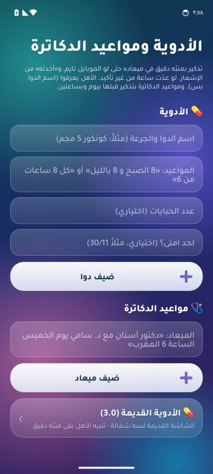 <b>الأدوية والدكاترة</b></td>
<td align="center" width="25%">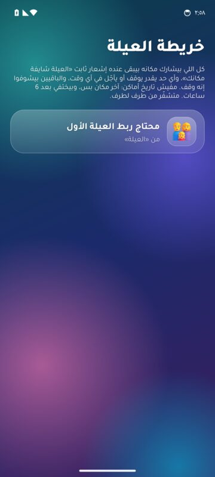 <b>خريطة العيلة</b></td>
<td align="center" width="25%">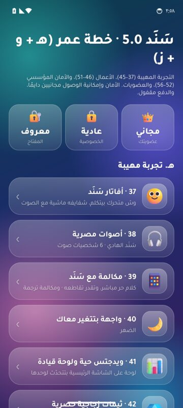 <b>التجربة والأعمال</b></td>
</tr>
<tr>
<td align="center" width="25%">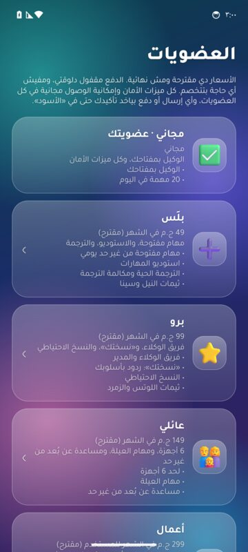 <b>العضويات (مقترحة)</b></td>
<td align="center" width="25%">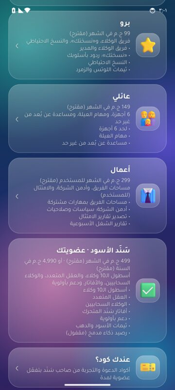 <b>سَنَد الأسود</b></td>
<td align="center" width="25%"> <b>لوحة الأدمن</b></td>
<td align="center" width="25%">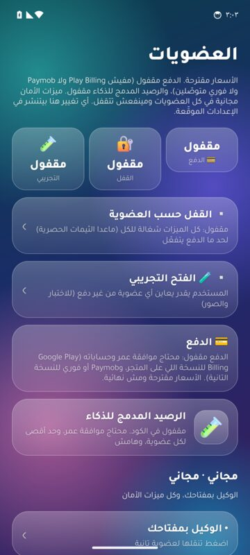 <b>العضويات في الأدمن</b></td>
</tr>
</table>

 

**لقطات أكتر حسب القسم** · More screens by section (tap to expand)

<b>🧠 عقل الوكيل والذكاء · Agent brain & AI</b> · 8 لقطات

 

<table>
<tr>
<td align="center" width="25%">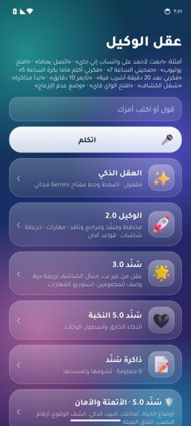 <b>عقل الوكيل</b></td>
<td align="center" width="25%">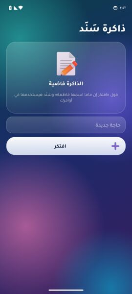 <b>ذاكرة سَنَد</b></td>
<td align="center" width="25%">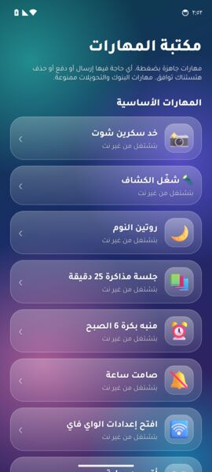 <b>مكتبة المهارات</b></td>
<td align="center" width="25%">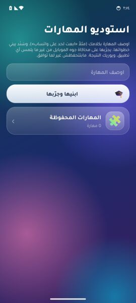 <b>استوديو المهارات</b></td>
</tr>
<tr>
<td align="center" width="25%">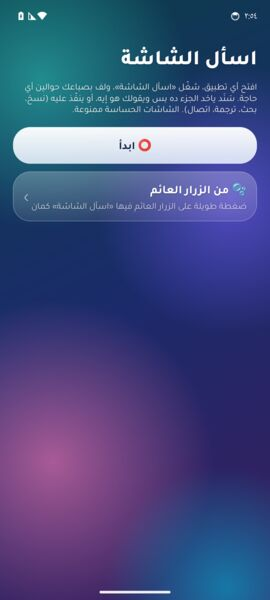 <b>اسأل الشاشة</b></td>
<td align="center" width="25%">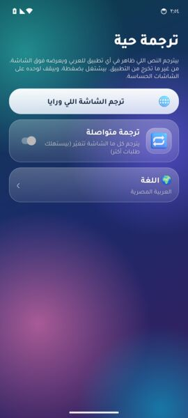 <b>ترجمة حية</b></td>
<td align="center" width="25%">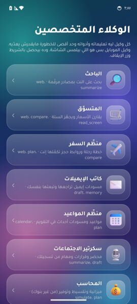 <b>الوكلاء المتخصصين</b></td>
<td align="center" width="25%">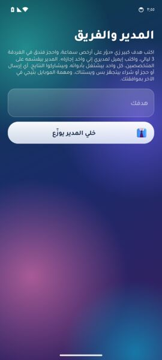 <b>المدير والفريق</b></td>
</tr>
</table>

<b>⚙️ الأتمتة · Automations</b> · 6 لقطات

 

<table>
<tr>
<td align="center" width="33%">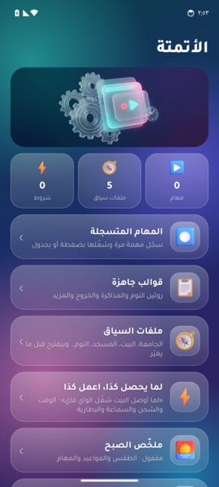 <b>الأتمتة</b></td>
<td align="center" width="33%">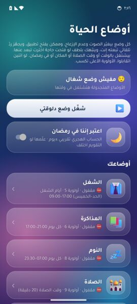 <b>أوضاع الحياة</b></td>
<td align="center" width="33%">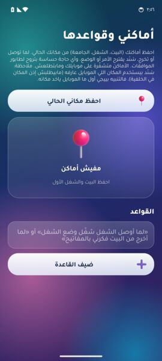 <b>أماكني وقواعدها</b></td>
</tr>
<tr>
<td align="center" width="33%">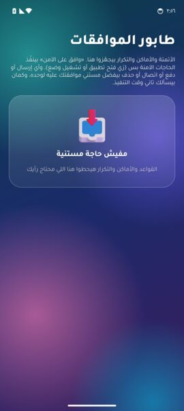 <b>طابور الموافقات</b></td>
<td align="center" width="33%"> <b>البيت الذكي</b></td>
<td align="center" width="33%">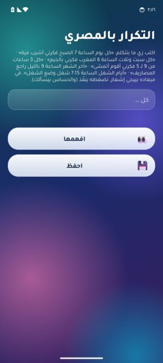 <b>التكرار بالمصري</b></td>
</tr>
</table>

<b>👨‍👩‍👧 العيلة والحماية · Family & safety</b> · 6 لقطات

 

<table>
<tr>
<td align="center" width="33%">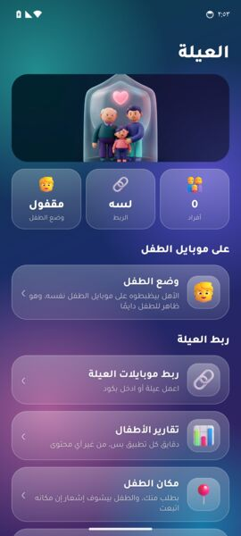 <b>وضع الطفل</b></td>
<td align="center" width="33%">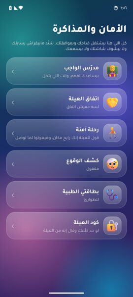 <b>الأمان والمذاكرة</b></td>
<td align="center" width="33%"> <b>وضع الجد والجدة</b></td>
</tr>
<tr>
<td align="center" width="33%">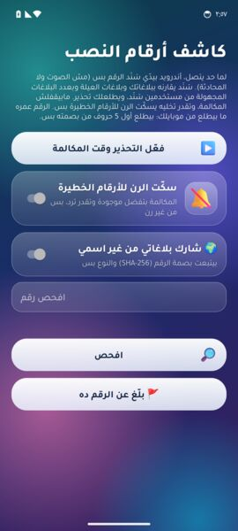 <b>كاشف أرقام النصب</b></td>
<td align="center" width="33%">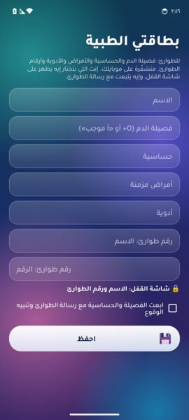 <b>بطاقتي الطبية</b></td>
<td align="center" width="33%">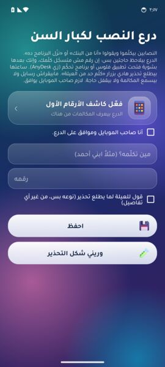 <b>درع النصب لكبار السن</b></td>
</tr>
</table>

<b>✨ التجربة والأعمال · Experience & business</b> · 6 لقطات

 

<table>
<tr>
<td align="center" width="33%">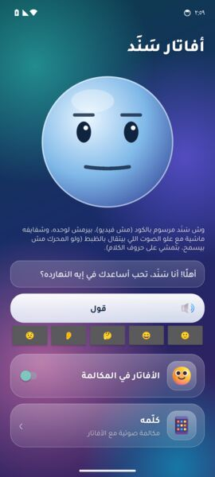 <b>أفاتار سَنَد</b></td>
<td align="center" width="33%">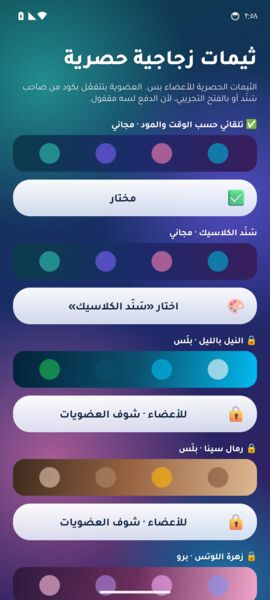 <b>الثيمات الزجاجية</b></td>
<td align="center" width="33%">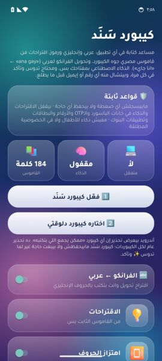 <b>كيبورد سَنَد</b></td>
</tr>
<tr>
<td align="center" width="33%">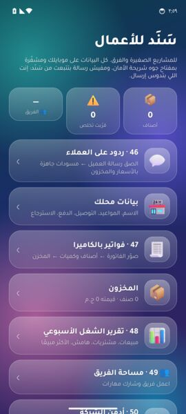 <b>سَنَد للأعمال</b></td>
<td align="center" width="33%">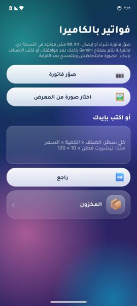 <b>فواتير بالكاميرا</b></td>
<td align="center" width="33%">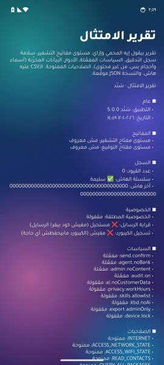 <b>تقرير الامتثال</b></td>
</tr>
</table>

<b>🔒 الخصوصية والأمان · Privacy & safety</b> · 6 لقطات

 

<table>
<tr>
<td align="center" width="33%">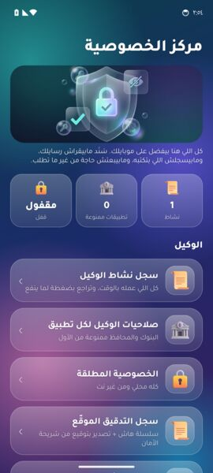 <b>مركز الخصوصية</b></td>
<td align="center" width="33%">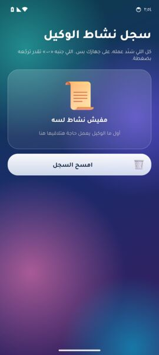 <b>سجل نشاط الوكيل</b></td>
<td align="center" width="33%">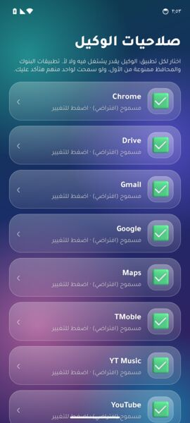 <b>صلاحيات الوكيل</b></td>
</tr>
<tr>
<td align="center" width="33%">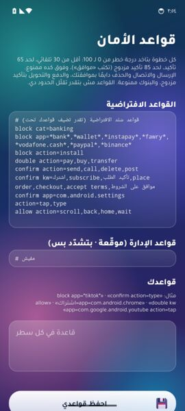 <b>قواعد الأمان</b></td>
<td align="center" width="33%">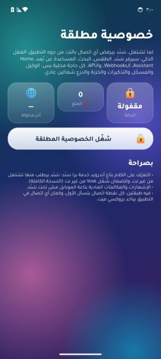 <b>خصوصية مطلقة</b></td>
<td align="center" width="33%">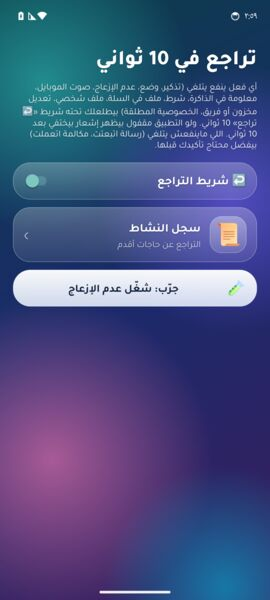 <b>تراجع 10 ثواني</b></td>
</tr>
</table>

<b>💎 العضويات وتطبيق الأدمن · Memberships & admin app</b> · 9 لقطات

 

<table>
<tr>
<td align="center" width="33%">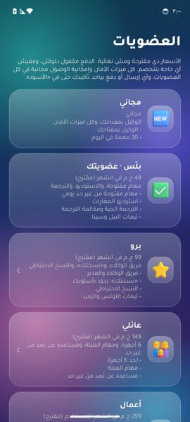 <b>العضويات · Plus</b></td>
<td align="center" width="33%">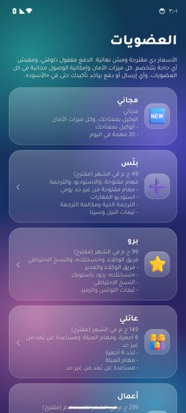 <b>العضويات · سَنَد الأسود</b></td>
<td align="center" width="33%">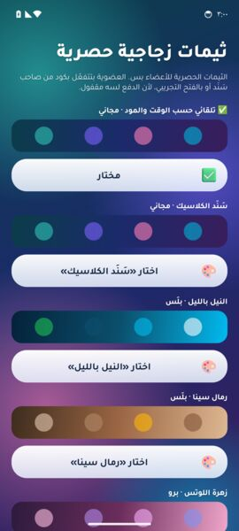 <b>الثيمات الزجاجية · سَنَد الأسود</b></td>
</tr>
<tr>
<td align="center" width="33%">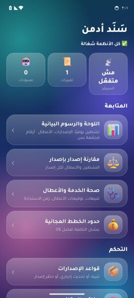 <b>أدمن · الرئيسية</b></td>
<td align="center" width="33%">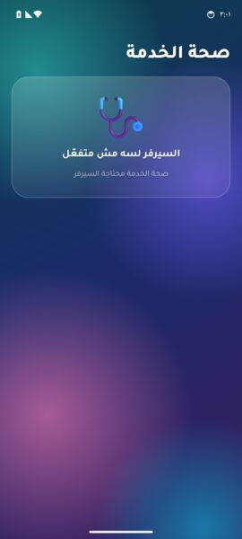 <b>أدمن · صحة السيرفر</b></td>
<td align="center" width="33%"> <b>أدمن · المفاتيح</b></td>
</tr>
<tr>
<td align="center" width="33%"> <b>أدمن · الشفافية</b></td>
<td align="center" width="33%"> <b>أدمن · الوكلاء السحابيين</b></td>
<td align="center" width="33%"> <b>أدمن · اللي الأدمن مايقدرش يعمله</b></td>
</tr>
</table>

##  المعمار · Architecture

###  جيش الوكلاء · Agent-army flow

###  موجات 6.0 «الأفق» · Waves A–G

##  وعود الأمان والخصوصية · Safety &amp; privacy promises

<table>
<tr>
<td width="50%" valign="top">

 **الأمان مجاني ومش بيتقفل** في أي عضوية. Safety and accessibility are free in every tier, forever.

 **محدش يشوف محتواك**، ولا المالك نفسه. الأدمن ووكلاء الأمن بيشوفوا أرقام مجمّعة بس. No one reads your content, not even the owner.

 **الذكاء على الجهاز أولًا**، وبمفتاحك إنت لو اخترت سحابة. On-device AI first; cloud AI only with your own key.

 **مفيش إرسال أو دفع من غير موافقتك** على النص والمستلم والمبلغ بالظبط. Nothing is sent or paid without your explicit approval.

</td>
<td width="50%" valign="top">

 **التراجع أولًا**: أي فعل ليه إلغاء بيتعرض قبل التنفيذ، و10 ثواني تراجع في الحاجات الخطيرة. Undo first, with a 10-second window on risky actions.

 **وضع الطفل ظاهر ومعلن**: مفيش تجسس، ومفيش إرسال أو شراء من الوكلاء. Child mode is visible and consent-based, never spyware.

 **صدّر بياناتك أو امسحها كلها** في ضغطة (قانون 151 لسنة 2020) · بتتبني في الموجة D. One-tap export or erase (Egypt PDPL 151/2020), being built in wave D.

 **مفيش مفاتيح ولا أسرار في الكود**: فحص مفاتيح على كل إصدار. No keys in the binary; every release passes a key scan.

</td>
</tr>
</table>

##  رحلة الإصدارات · Changelog

| الإصدار | الاسم | أبرز ما فيه | الحالة |
|:--:|:--|:--|:--:|
| **1.0** | الأساس | الوكيل بالمصري، ووضع الطفل، والأقسام الخمسة، وتطبيق الأدمن، وسيرفر Cloudflare، و160 ميزة | ✅ |
| **2.0** | العقل القابل للاختبار | عقل وكيل نقي بيتختبر من غير موبايل، وأمان في مكان واحد | ✅ |
| **3.0** | استوديو المهارات | مهارة من وصف بالكلام، و«اسأل الشاشة»، وترجمة حية، وذاكرة الموبايل | ✅ |
| **4.0** | الفريق والعضويات | خطة: فريق وكلاء، و«نسختك»، وطابور الموافقات، ومتجر مهارات موقّع، والبيت الذكي | ↪️ اندمجت في 5.0 |
| **5.0.0** | «النخبة» | ذكاء خارق، وأسطول وكلاء، وأتمتة، وحماية العيلة، وتجربة مهيبة، و165/165 شاشة على المحاكي، و4,426 اختبار JDK | ✅ مستقر |
| **6.0** | «الأفق» | جيش الوكلاء بالـ12 كتيبة، والدستور، و4 مستويات موافقة، و8 عضويات، ومركز الأمن الذكي، ونظام العدل | 🔄 الموجات A–C خلصت · 7,149 / 0 |

##  English

**Sanad (سَنَد, "support")** is an Android AI agent that understands Egyptian Arabic and works the phone for you. It reads the screen, carries out tasks step by step, remembers what matters to you, and protects your family. Everything runs inside clear safety rules.

**6.0 «الأفق» (Horizon)** adds a free agent army that can work for you over days and weeks:

- 🎖️ **Commander + 12 battalions**: money, travel, shopping, study, health, work, home, family, legal & paperwork, content & design, coding, research. Free agents are created on demand and sandboxed first.
- 📜 **Constitution**: 10 articles checked in code before every action. Humans decide. No impersonation, nothing illegal, and budget caps can't be broken.
- 🚦 **4 approval levels**: 🟢 free · 🟡 standing grant · 🟠 per action · 🔴 strict (biometric, 10-second undo, amount cap).
- 💎 **8 membership tiers**, from Free to Sovereign. All prices are **proposed**, and payments stay **off** until the owner approves a licensed gateway.
- 👑 **Owner app + 5 admin ranks** with a two-person rule, passkeys, and an append-only audit log.
- 🛡️ **AI security center**: Guardian, Fraud Hunter, Red Team, Fixer, Incident Lead, Auditor. They see patterns, never content.
- ⚖️ **Fairness system**: a reminder 3 days before renewal, 2-tap cancel, a full refund within 7 days, and human review of any suspension within 48 h.

| | |
|:--|:--|
| **Platform** | Android 7.0+ (API 24), target 34 / Play build 36, separate admin app |
| **Backend** | One Cloudflare Worker + one SQLite Durable Object (free tier) |
| **AI** | On-device first; cloud models only with the user's own key, via a cost-aware router |
| **Quality** | 5.0: 4,426 JDK assertions + 165/165 emulator screens, 0 crashes · 6.0 waves so far: **7,149 / 0** |
| **This repo** | Private CI: APK builds, tests, and Android emulator screenshots |

<b>Credits</b>

- 3D emoji: [Microsoft Fluent Emoji](https://github.com/microsoft/fluentui-emoji) (MIT).
- Wordmark: Tajawal (SIL Open Font License 1.1), outlined to SVG paths so no web fonts load.
- Hero, typing, divider and footer art: hand-written animated SVG in this repo (`assets/`).
- Badges: [shields.io](https://shields.io).

